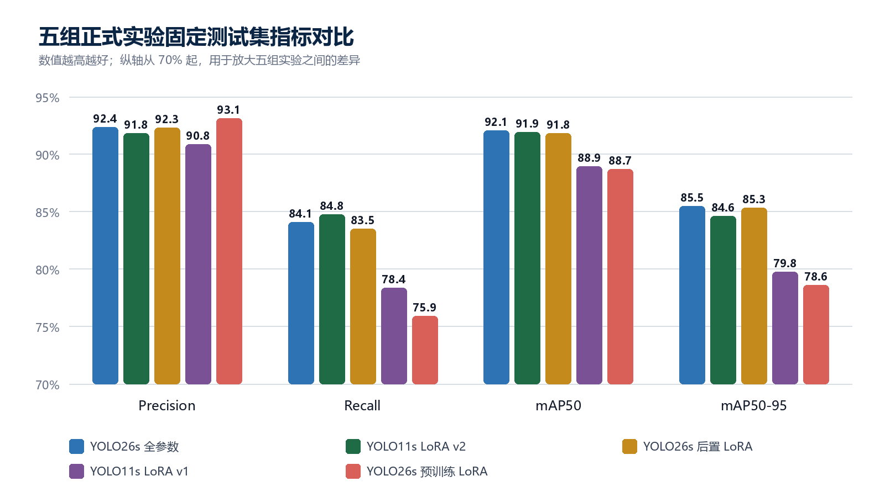

# 管道泄漏智能检测系统模型方案对比分析报告

> 客户评审版 V1.0  
> 报告日期：2026 年 7 月 19 日  
> 评审范围：YOLO26s 全参数微调、YOLO11s LoRA v2/v3、YOLO26s LoRA 两类方案

## 一、执行摘要

本次评估针对管道裂纹、可见积水和疑似泄漏三类目标，对已经完成的正式模型进行了统一测试。综合检测精度、漏检风险、推理效率和后续适配成本，建议采用以下双层模型方案：

1. **生产部署与客户演示主模型：YOLO26s 全参数微调模型。**
   - 综合定位精度最高，mAP50-95 为 **85.47%**。
   - mAP50 为 **92.05%**。
   - 单张图片模型推理约 **6.56 ms**，在当前候选模型中速度最快。

2. **低成本领域适配模型：YOLO11s LoRA v3。**
   - Recall 为 **84.75%**，是当前核心候选模型中的最高值。
   - mAP50 为 **91.92%**，与 YOLO26s 全参数模型仅相差 0.14 个百分点。
   - 可训练参数约占模型参数的 17.36%，适合后续针对新工地、新相机和新环境快速更新。

YOLO11s LoRA v3 已经全面超过 LoRA v2。YOLO26s 从官方预训练权重直接进行 LoRA 微调的 Recall 偏低，不适合作为当前泄漏检测主模型；在完整模型上追加 LoRA 也没有继续提升精度，更适合作为未来新场景适配手段。

## 二、测试范围与评价原则

本次对比使用相同的数据处理规范和固定测试划分：

- 训练集：2,816 张图片。
- 验证集：251 张图片。
- 固定测试集：251 张图片。
- 测试集目标：crack 18 个、water 84 个、leak 102 个。
- 测试集无目标图片：53 张，用于评估复杂背景下的误报情况。

评价指标说明：

- **Precision（精确率）**：预测为异常的目标中，有多少是真实异常。该值越高，误报越少。
- **Recall（召回率）**：真实异常目标中，有多少被成功检出。该值越高，漏检越少。
- **mAP50**：在 IoU=0.50 条件下的综合检测精度。
- **mAP50-95**：在多个更严格 IoU 阈值下计算的综合精度，更能反映检测框定位质量。

管道泄漏场景中，漏检通常比普通误报具有更高风险，因此模型选择优先关注 Recall，同时结合 mAP50-95、推理速度和实际部署成本进行综合判断。

## 三、正式模型指标对比

| 模型与方法 | Precision | Recall | mAP50 | mAP50-95 | 推理时间 |
|---|---:|---:|---:|---:|---:|
| **YOLO26s 全参数微调** | **92.37%** | 84.10% | **92.05%** | **85.47%** | **6.56 ms** |
| **YOLO11s LoRA v3** | 91.83% | **84.75%** | 91.92% | 84.63% | 7.52 ms |
| YOLO26s 完整模型后追加 LoRA | 92.32% | 83.53% | 91.83% | 85.33% | — |
| YOLO11s LoRA v2 | 90.85% | 78.36% | 88.94% | 79.75% | 7.42 ms |
| YOLO26s 从官方预训练模型做 LoRA | 93.14% | 75.93% | 88.68% | 78.62% | 7.23 ms |

> 注：推理时间为当前测试设备上的模型核心推理耗时，不包含视频解码、图像绘制、网络传输和结果存储时间。

## 四、各模型与训练方法分析

### 4.1 YOLO26s 全参数微调

全参数微调会更新模型中的全部可训练参数，能够充分学习当前管道泄漏数据集的视觉特征。

该方案的主要优势如下：

- mAP50-95 为 85.47%，是当前正式模型中的最高值。
- mAP50 为 92.05%，说明常规目标检出和定位表现稳定。
- 推理时间约为 6.56 ms，适合图片检测和逐帧视频检测。
- crack、water、leak 三类目标的 mAP50-95 分别为 84.55%、84.62% 和 87.26%，类别表现较均衡。

该方案的主要成本是训练时间和计算资源较高。本次正式训练共完成 139 个 epoch，约耗时 5.85 小时，最佳验证结果出现在第 114 个 epoch。

**方案定位：作为当前生产部署、客户演示、图片检测和视频检测的主模型。**

### 4.2 YOLO11s LoRA v3

LoRA 通过训练低秩适配器减少需要更新的参数量。由于原始预训练模型使用通用类别，本项目还需要同步训练新的三分类检测头。

LoRA v3 的主要优势如下：

- Recall 为 84.75%，比 YOLO26s 全参数模型高 0.66 个百分点。
- mAP50 为 91.92%，与 YOLO26s 全参数模型仅相差 0.14 个百分点。
- mAP50-95 为 84.63%，与 YOLO26s 全参数模型相差 0.84 个百分点。
- 正式训练完成 100 个 epoch，约耗时 2.66 小时，最佳验证 mAP50-95 出现在第 98 个 epoch。
- 可训练参数约占模型参数的 17.36%，LoRA Adapter 文件约为 3.79 MB。

需要说明的是，LoRA 主要减少的是**增量训练与适配器分发成本**。当模型合并为可独立部署的完整权重后，文件仍约为 20.41 MB，并不会因为使用 LoRA 自动变成只有几 MB 的完整检测模型。

**方案定位：作为低成本领域适配方案，同时保留为高 Recall 备选模型。**

### 4.3 在完整 YOLO26s 模型上追加 LoRA

该方案以已经完成全参数微调的 YOLO26s 模型为基础，再训练一组 LoRA Adapter。

追加训练约耗时 0.68 小时，但最终结果没有超过原始完整模型：

- Precision 下降约 0.05 个百分点。
- Recall 下降约 0.57 个百分点。
- mAP50 下降约 0.22 个百分点。
- mAP50-95 下降约 0.15 个百分点。

因此，该方法不应作为当前精度提升方案。它更适合未来面对新工地、新相机或明显不同的数据分布时，用较低成本进行快速领域适配。

### 4.4 从官方预训练模型直接进行 YOLO26s LoRA 微调

该实验与 YOLO26s 全参数模型从相同的官方预训练权重出发，能够较公平地比较全参数微调和 LoRA 微调。

LoRA 分支只训练约 11.58% 的参数，但结果表现出明显的 Precision/Recall 偏向：

- Precision 达到 93.14%，误报控制较好。
- Recall 只有 75.93%，漏检明显增加。
- mAP50-95 为 78.62%，比全参数模型低 6.86 个百分点。
- 正式训练约耗时 6.66 小时，并没有比全参数训练更快。

该结果说明：**减少可训练参数并不必然减少实际训练时间。** 训练轮次、混合精度设置、自定义模型分支和硬件利用率都会影响最终成本。

由于当前业务更重视减少泄漏漏检，该模型不建议作为生产部署候选。

## 五、YOLO11s LoRA v3 改进效果

LoRA v2 在第 69 个 epoch 提前停止，最佳验证 mAP50-95 出现在第 49 个 epoch。其学习率计划与实际训练长度不匹配，mosaic 增强也没有及时关闭，导致后期精细收敛不足。

LoRA v3 采用以下调整：

- 初始学习率由 0.001 降低到 0.0003。
- LoRA rank 从 8 提高到 16。
- LoRA dropout 从 0.05 降低到 0.02。
- patience 从 20 提高到 30。
- mosaic 强度降为 0.5，并在最后 40 个 epoch 关闭。
- 使用 100 epoch 的余弦学习率计划，使学习率下降过程与实际训练长度匹配。

### 5.1 v2 与 v3 核心指标

| 指标 | LoRA v2 | LoRA v3 | v3 提升 |
|---|---:|---:|---:|
| Precision | 90.85% | **91.83%** | **+0.98 个百分点** |
| Recall | 78.36% | **84.75%** | **+6.39 个百分点** |
| mAP50 | 88.94% | **91.92%** | **+2.98 个百分点** |
| mAP50-95 | 79.75% | **84.63%** | **+4.88 个百分点** |

### 5.2 各类别 mAP50-95

| 目标类别 | LoRA v2 | LoRA v3 | v3 提升 |
|---|---:|---:|---:|
| crack | 79.14% | **82.90%** | **+3.76 个百分点** |
| water | 78.27% | **83.62%** | **+5.35 个百分点** |
| leak | 81.84% | **87.37%** | **+5.53 个百分点** |

v3 在全部核心指标和全部目标类别上均超过 v2，其中 Recall 提升最明显。这说明新的学习率、LoRA rank 和增强关闭策略有效解决了 v2 的主要问题。

## 六、误差分析与阈值建议

LoRA v3 的类别间混淆较少，主要剩余问题来自复杂背景误报，其中 leak 类占背景误报的较大比例。下一阶段的主要优化空间更可能来自现场负样本覆盖和视频时序策略，而不是继续单纯增加训练轮次。

根据 LoRA v3 的 F1-Confidence 曲线：

- 综合 Precision 与 Recall 的参考最优置信度约为 **0.56**，对应综合 F1 约为 **0.88**。
- 如果业务更关注减少漏检，建议初始置信度设置为 **0.25-0.35**。
- 视频检测建议增加连续帧确认、告警合并和最短持续时间，避免单帧误报造成告警闪烁。
- IoU 阈值可以保持在 **0.50** 左右，用于抑制同一目标的重复检测框。

crack 在测试集中只有 18 个目标，类别指标对少量样本变化较敏感。客户现场验收时应重点补充裂纹样本并单独核查该类别的 Recall。

## 七、最终部署建议

### 7.1 推荐模型组合

| 模型角色 | 推荐模型 | 选择依据 | 建议用途 |
|---|---|---|---|
| **当前主模型** | **YOLO26s 全参数模型** | 综合定位精度最高，推理速度最快 | 生产部署、客户演示、图片和视频检测 |
| **领域适配模型** | **YOLO11s LoRA v3** | Recall 略高，训练和增量分发成本较低 | 新相机、新工地和新环境快速适配 |
| 归档模型 | YOLO11s LoRA v2 | 已被 v3 全面超过 | 历史实验对照 |
| 研究模型 | YOLO26s 预训练 LoRA | 漏检偏高，不符合当前优先级 | 微调方法验证 |

### 7.2 推荐实施顺序

1. 使用 YOLO26s 全参数模型完成当前版本的客户演示和生产基线部署。
2. 保留 YOLO11s LoRA v3 的完整权重与 Adapter，作为后续快速适配能力。
3. 使用客户现场独立采集的图片和视频进行最终验收。
4. 分别统计白天、夜间、反光、遮挡、积水和复杂背景条件下的 Recall 与误报率。
5. 根据现场验收结果锁定置信度阈值、IoU 阈值和视频连续帧告警策略。

## 八、结论

当前模型结果已经形成清晰的双层技术路线：

- **YOLO26s 全参数模型负责当前稳定交付。** 它在 mAP50-95 和推理速度上保持领先，是综合性能最好的生产候选模型。
- **YOLO11s LoRA v3 负责后续低成本适配。** 它以较少的可训练参数取得了接近主模型的精度，并获得当前最高 Recall，证明优化后的 LoRA 方案具有实际应用价值。

因此，建议最终采用“**YOLO26s 全参数主模型 + YOLO11s LoRA v3 适配模型**”的组合架构，在保证当前检测质量的同时，为客户现场环境变化和后续模型迭代保留低成本更新能力。

## 附录：数据口径与可追溯性

本报告仅纳入完成正式训练并通过固定测试集评估的模型。Smoke、预检、已中止实验和 YOLO26m 未完成方案不参与正式结论。

关键评估记录：

- `models/metrics/notebook_lora_v3_formal_internal_metrics.json`
- `models/metrics/notebook_lora_v2_internal_metrics.json`
- `models/metrics/yolo26s_full_768_internal_metrics.json`
- `models/metrics/yolo26s_lora_formal_internal_metrics.json`
- `models/metrics/yolo26s_lora_from_pretrained_formal_internal_metrics.json`
- `models/metrics/dataset_audit.json`

> 说明：不同架构模型之间的比较用于选择部署候选，不代表训练方法的严格因果实验。严格的全参数与 LoRA 方法对比，应保证模型架构、预训练权重、输入分辨率、数据划分和随机种子完全一致。
